# کافه‌بین — CafeBean

A Persian / RTL WooCommerce storefront, built as a portfolio piece to show what a
"طراحی و راه‌اندازی سایت فروشگاهی" project actually delivers: a shop that reads and behaves
like an Iranian store, not a translated template.

The whole site is reproducible from scripts. `docker compose up -d && ./scripts/setup.sh &&
./scripts/seed-products.sh` builds it from empty volumes in about six and a half minutes with
no manual steps.

> **کافه‌بین** یک برند فرضی است. این سایت نمونه‌کار است و سفارش‌ها واقعی نیستند.

---

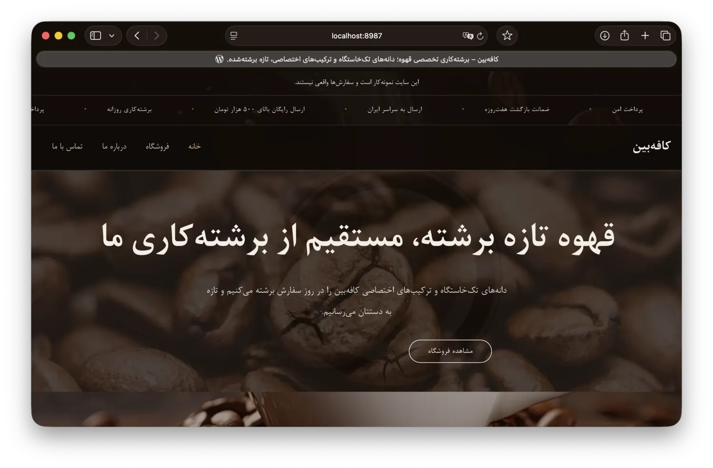

## What it demonstrates

Most WooCommerce demos stop at installing a theme. The work here is in the places a Persian
store differs from the default:

| | |
| --- | --- |
| **Currency** | Iranian Toman, no decimals, `تومان` suffix |
| **Digits** | Persian ۰-۹ on the front end, ASCII in admin, REST and JSON-LD |
| **Checkout** | استان dropdown, required کد پستی and موبایل, server-side validation |
| **Input** | Persian and Arabic-Indic digits normalised before validation and storage |
| **Shipping** | پیک تهران for Tehran, پست پیشتاز elsewhere, free above a threshold |
| **Payment** | Zarinpal (sandbox) + پرداخت در محل |
| **Typography** | B Nazanin, self-hosted — no Google Fonts, no external CDN |

---

## Screenshots

### Storefront

| | |
| --- | --- |
| 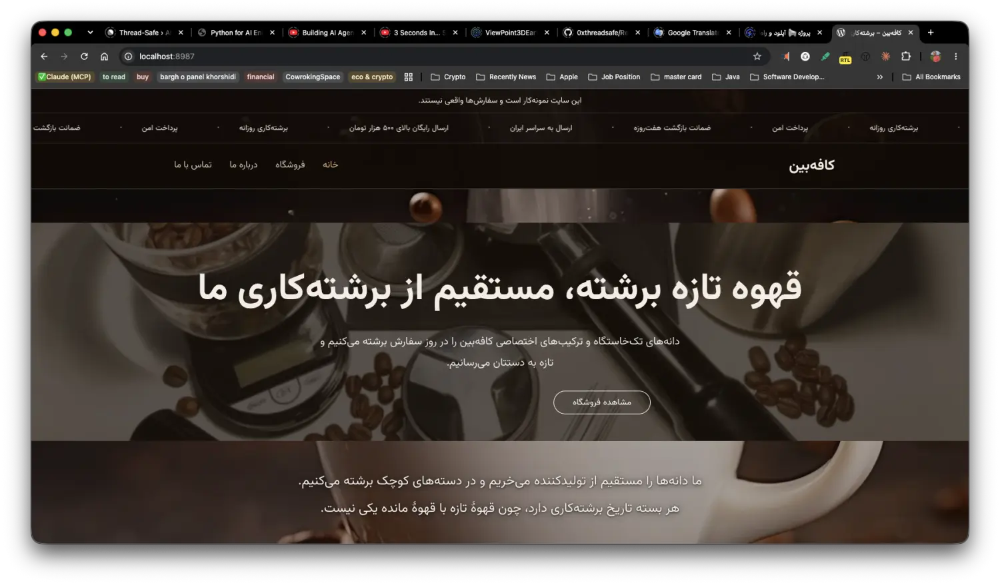 | 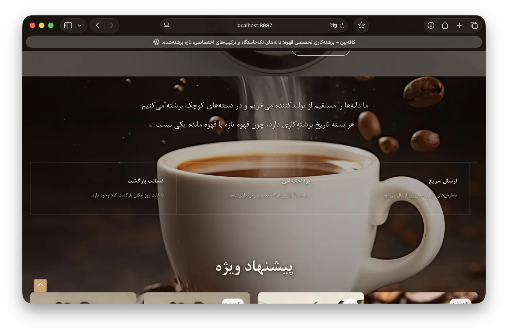 |
| Rotating hero, four images, CSS crossfade | Full-bleed statement band |
| 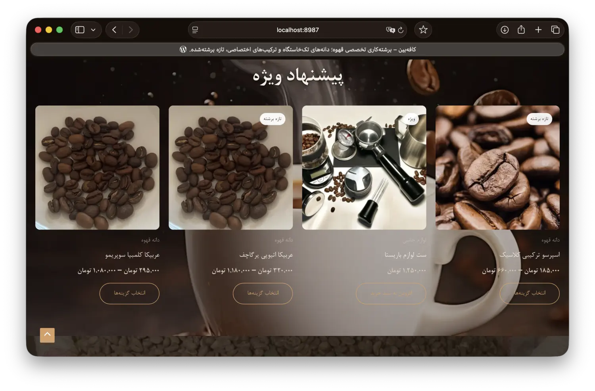 | 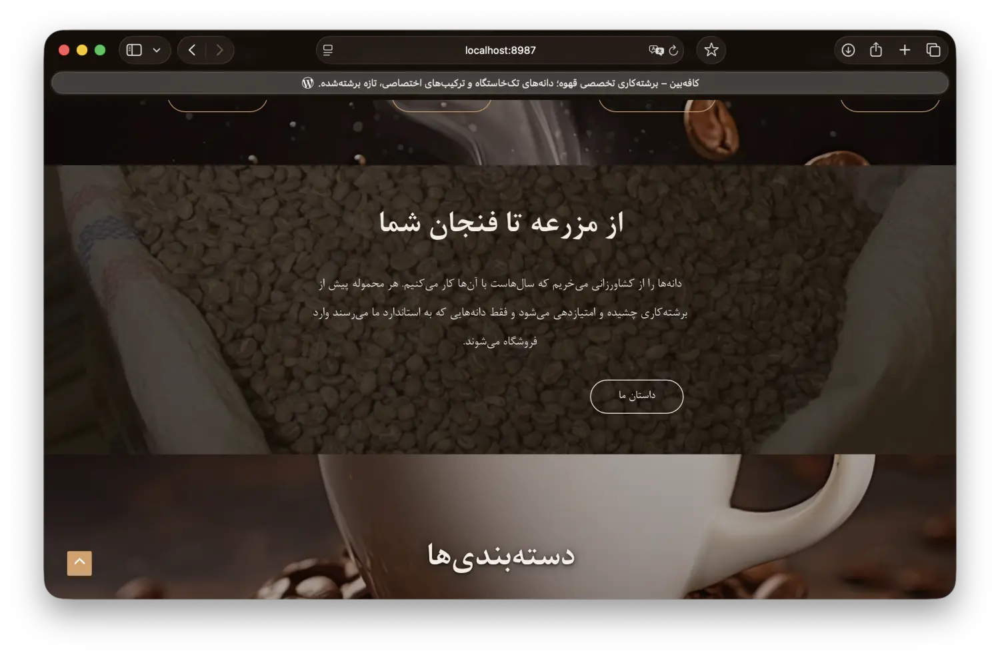 |
| Featured products with per-product badges | Story band |
| 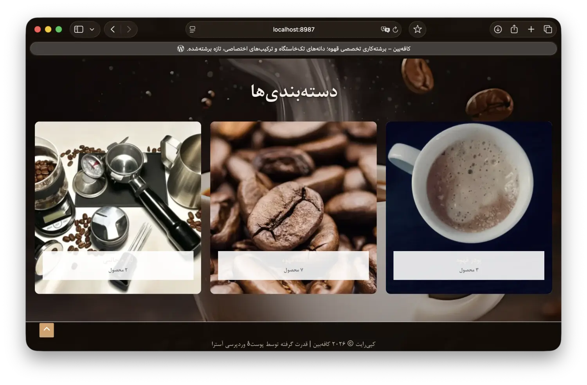 | 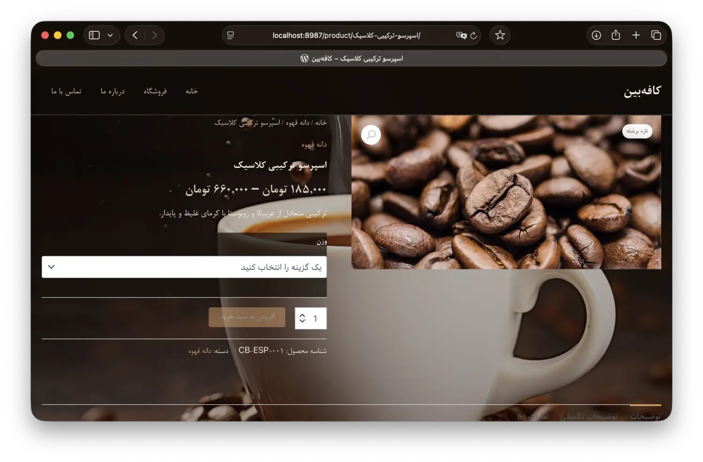 |
| Category tiles | Variable product — وزن ۲۵۰/۵۰۰/۱۰۰۰ گرم |

### Cart and checkout

The free-shipping bar computes its figure the same way `WC_Shipping_Free_Shipping` does, so it
cannot promise a rate the checkout then refuses.

| | |
| --- | --- |
| 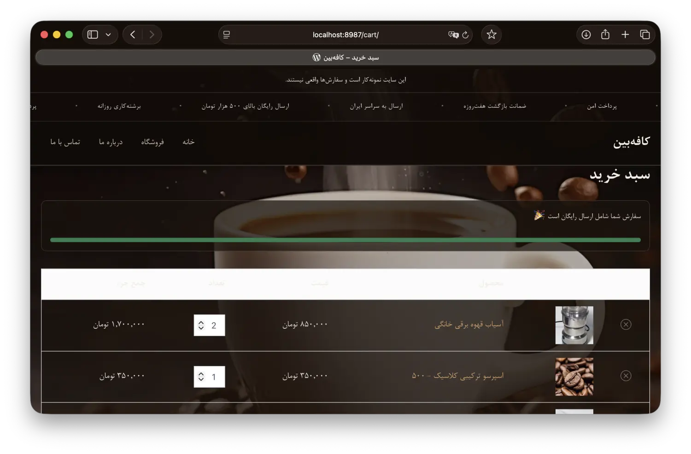 | 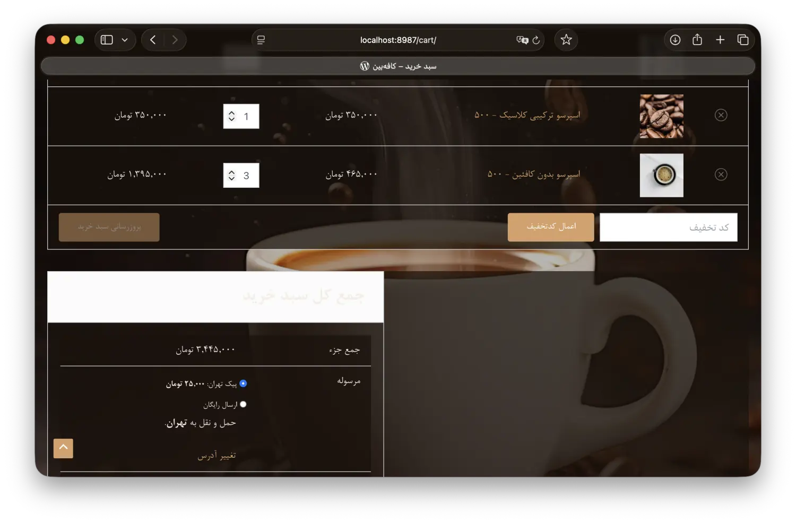 |
| Threshold reached | Cart with variations and shipping choice |
| 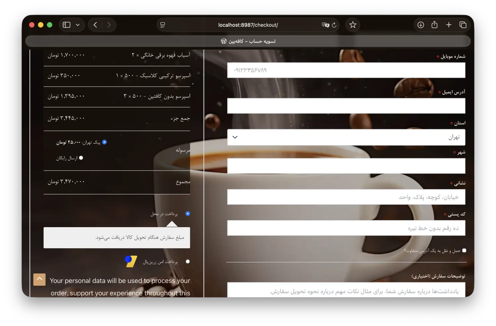 | 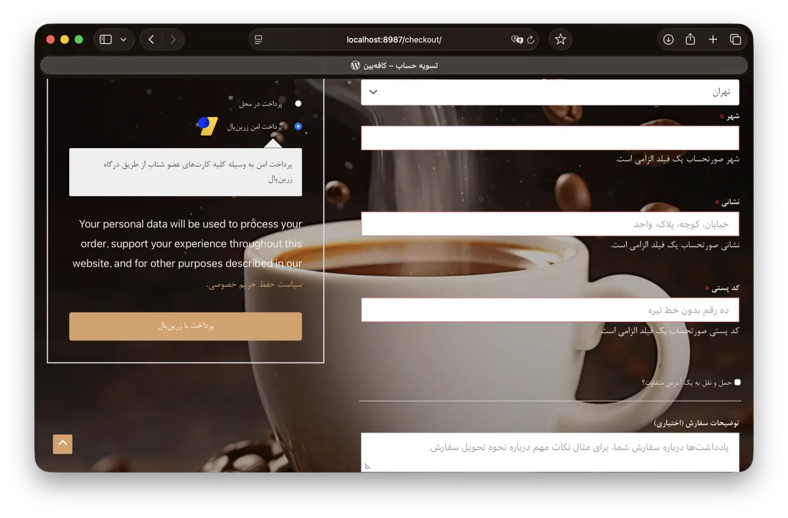 |
| استان، کد پستی، موبایل — company and address_2 removed | Server-side validation and gateway choice |

### Mobile

Checked at 360px: no horizontal scroll on any page.

| | | |
| --- | --- | --- |
| 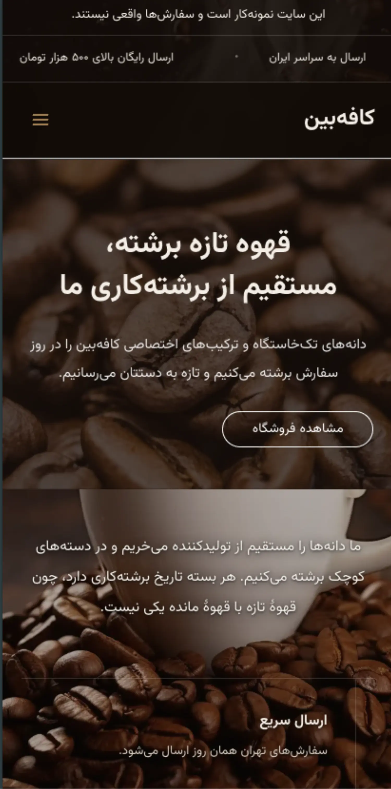 | 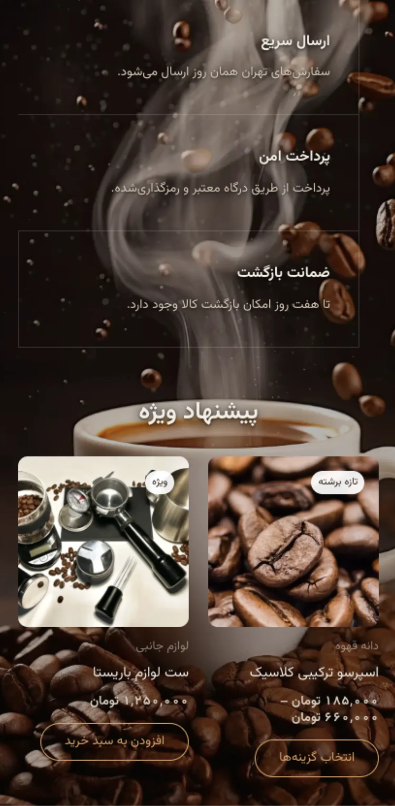 | 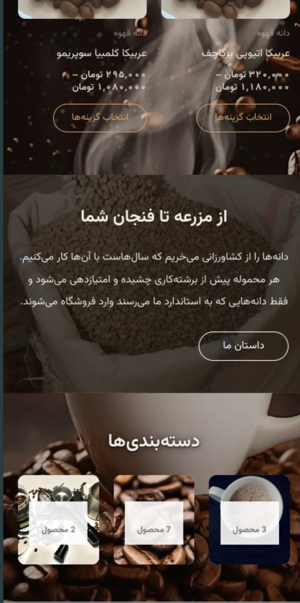 |

---

## Measured results

Lighthouse, mobile emulation, home and shop:

| Metric | Score | Target |
| --- | --- | --- |
| Performance | 92 | ≥ 85 |
| Accessibility | 100 | ≥ 90 |
| Best Practices | 100 | — |
| SEO | 100 | ≥ 95 |

Also verified: a COD order placed end to end, `debug.log` empty with `WP_DEBUG` on, no
horizontal scroll at 360px, and both scripts re-runnable without duplicating anything.

---

## Architecture

```
wp-content/
├── themes/cafebean-child/        # presentation; all custom CSS and display hooks
│   ├── inc/setup.php             # theme supports, fonts, preloads
│   ├── inc/woocommerce.php       # Persian digits, badges, price display
│   ├── inc/checkout.php          # Iranian checkout fields + validation
│   ├── inc/cart.php              # free-shipping progress bar
│   ├── inc/hero.php              # rotating hero, deferred image loading
│   └── inc/performance.php       # dequeue unused assets
└── mu-plugins/
    ├── cafebean-core.php         # digit helpers, product meta, meta description
    └── cafebean-forms.php        # contact form, trust badges, ticker
```

The split is deliberate. Anything that must survive a theme switch — digit normalisation used
by checkout validation, product meta, the free-shipping threshold — lives in `mu-plugins/`.
The child theme only presents.

No parent theme or plugin file is edited. Every function, option and CSS class is prefixed
`cafebean_` / `.cb-`.

### Scripts

| Script | Does |
| --- | --- |
| `scripts/setup.sh` | Installs WordPress (fa_IR), plugins, theme, pages, menus, shipping zones, gateways, SEO |
| `scripts/setup.sh --force-pages` | Same, but also rewrites page content edited in wp-admin |
| `scripts/seed-products.sh` | Imports `data/products.csv` through the WooCommerce CRUD API |
| `scripts/export.sh [url]` | Produces `dist/db.sql` + `dist/wp-content.tar.gz`, optionally rewritten to a target domain |

`setup.sh` is idempotent, and it will not overwrite page content a human edited — each
generated page carries a checksum of what the script last wrote.

`export.sh` refuses to run unless Zarinpal is in sandbox mode, so a bundle that could take a
real payment is never produced.

---

## Running it

```bash
cp .env.example .env          # edit credentials
docker compose up -d
./scripts/setup.sh
./scripts/seed-products.sh
```

Then open `http://localhost:8987`. Admin credentials come from `.env`, which is gitignored.

Stack: WordPress 7.1.2, WooCommerce 11.1.2, PHP 8.2, MariaDB 10.11, Astra (free) as parent theme.

---

## Deviations from the original plan

Both deliberate, both documented in `CLAUDE.md`:

- **Elementor is not installed.** Pages are core block markup written by
  `scripts/setup-pages.php`, so layouts are reproducible from a script with no builder state in
  the database.
- **The sitemap and meta descriptions do not come from Rank Math.** Rank Math only registers
  its sitemap routes and emits front-end meta after its *interactive* setup wizard, which a
  script cannot drive. The sitemap is WordPress core's `/wp-sitemap.xml`; the description tag
  is emitted by the mu-plugin. Rank Math still handles titles and breadcrumbs.

---

## Third-party assets

- **Product photography** in `data/images/` is public domain or CC0, sourced from Wikimedia
  Commons. Provenance is recorded in [`data/images/CREDITS.md`](data/images/CREDITS.md).
- **B Nazanin** (`wp-content/themes/cafebean-child/assets/fonts/`) is a commercial font from
  Borna Rayaneh, included here for demonstration. Anyone reusing this repository needs their
  own licence for it; swapping in an OFL face such as Vazirmatn or Sahel is a two-file change.
- **The background photograph** is a stock image used for the demo only.

No real personal data appears anywhere — all phone numbers, addresses and emails are clearly
fictional placeholders.
